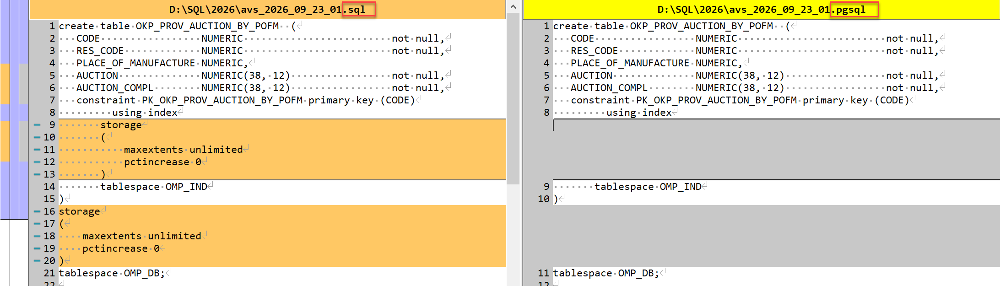

## Postgres в Омеге

### Data Types - Типы данных

- `OMPCODE`, `CODE64` - общий double для pg и ora - `NUMERIC`
- `double` - общий double для pg и ora - `NUMERIC(38, 12)`

### Создание таблиц

Для pg нужно указывать `tablespace`, но не нужно указывать `storage`, соответственно из скрипта для pg удаляем `storage`.
